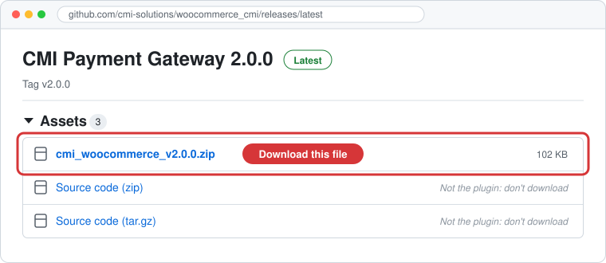
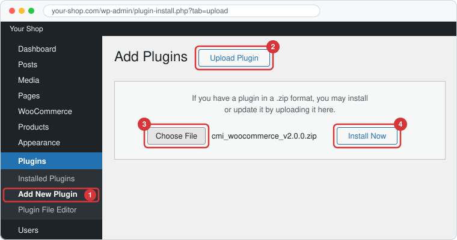
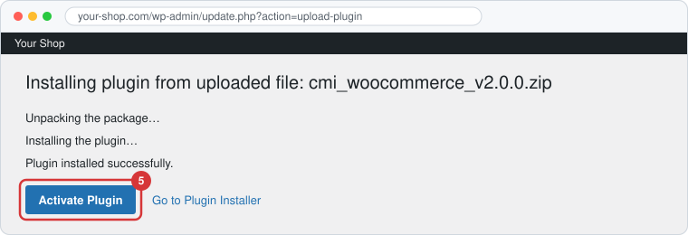
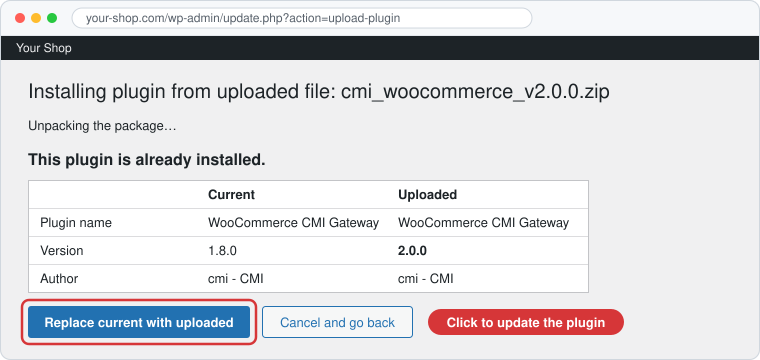

# WooCommerce CMI Gateway

A WooCommerce payment gateway for [CMI](https://www.cmi.co.ma/) (Centre Monétique Interbancaire, Morocco). Customers pay on CMI's secure hosted page, and merchants can confirm, void, refund and check payments directly from WooCommerce.

Updating from an earlier version? Read the [changelog](CHANGELOG.md) first: version 2.0.0 changes how some things work.

## Supported versions

| Component | Minimum | Tested up to |
| --- | --- | --- |
| PHP | 8.3 | – |
| WordPress | 6.7 | 7.1.4 |
| WooCommerce | 9.0 | 11.2.2 |

The plugin supports:

- **High-Performance Order Storage (HPOS)**, WooCommerce's order storage, as well as the older storage in WordPress posts.
- **Cart & Checkout Blocks**, as well as the classic checkout.

## Features

- **Secure hosted payment:** customers enter their card details on CMI's 3-D Secure page, never on your site.
- **Automatic or manual capture:** capture the payment immediately, or pre-authorize it and confirm later.
- **Manage payments from WooCommerce:** confirm, void, refund (full or partial) and check a payment's status at CMI, from the orders list or the order page.
- **Other currencies:** CMI always charges in MAD. Orders in other currencies are converted, show both amounts, and are refunded using the rate applied at payment.
- **Supported currency plugins:** FOX / WOOCS, WPML + WCML, CURCY and Aelia Currency Switcher, or your own rates.
- **Same order number everywhere:** orders show the same number in WooCommerce and in the CMI back office.
- **Safe with several websites:** if one CMI account is used by several websites, the plugin never acts on another website's payment.
- **Stays in sync with the CMI back office:** a payment confirmed or voided in CMI updates the order in WooCommerce.
- **Old pre-authorization warning:** before confirming a pre-authorization older than 5 days, you're advised to inform the customer, to reduce the risk of chargebacks.
- **English and French**, following your WordPress language.

## Installation

Before you start, make sure **WooCommerce is installed and active**, and that your site meets the [supported versions](#supported-versions).

### 1. Download the plugin

1. Open the **[latest release](https://github.com/cmi-solutions/woocommerce_cmi/releases/latest)**.
2. Under **Assets**, click **`cmi_woocommerce_vX.Y.Z.zip`** (for example `cmi_woocommerce_v2.0.0.zip`) to download it.

> [!IMPORTANT]
> - Don't download **Source code (zip)** or **Source code (tar.gz)**. They contain the whole project, not an installable plugin.
> - **Don't unzip the file:** WordPress installs the zip as it is. Safari on Mac may unzip downloads automatically. If you get a `cmi` folder instead of a zip, download it again with another browser, or turn off **Open "safe" files after downloading** in Safari's settings.

### 2. Install it in WordPress

1. In your WordPress admin, go to **Plugins → Add New Plugin**.
2. Click **Upload Plugin** at the top of the page.
3. Click **Choose File** and select the `cmi_woocommerce_vX.Y.Z.zip` file you downloaded.
4. Click **Install Now**.

5. When WordPress shows **Plugin installed successfully**, click **Activate Plugin**.

### 3. Configure it

Open **WooCommerce → Settings → Payments → CMI** and enter the details provided by CMI (see [Configuration](#configuration)). Before going live, test a payment, a confirmation and a refund using CMI's test environment.

### Updating from an earlier version

1. Read the [changelog](CHANGELOG.md) first: some versions change how the plugin works.
2. Download the new zip and upload it in exactly the same way (steps 1 to 4 above). You don't need to deactivate or delete the current version, and your settings are kept.
3. WordPress shows **This plugin is already installed**, with the current and uploaded versions. Click **Replace current with uploaded**.

If WordPress installs it as a second CMI plugin instead of offering to replace it, the zip wasn't the one from **Assets**. Deactivate and delete the extra plugin, then upload `cmi_woocommerce_vX.Y.Z.zip`. Deleting a CMI plugin removes the CMI connection credentials, so enter them again in the settings afterwards.

**Your shop must be reachable from the internet.** CMI contacts your shop after each payment, and in Automatic mode this is what captures the payment. A site running only on your computer won't receive these messages.

**Deleting the plugin** (from the Plugins page, not just deactivating it) removes the CMI connection credentials: Client ID, Store Key, payment page URL, and API URL, username and password. Your other settings and all order data are kept, so past orders keep their payment history.

## Configuration

All settings are in **WooCommerce → Settings → Payments → CMI**. Fields marked with * are required.

| Section | Settings |
| --- | --- |
| General | Enable CMI, payment title and description shown at checkout |
| Payment Setup | Kit type, confirmation mode, order status after capture, payment page language, automatic redirect, order identifier prefix |
| Gateway Connection | Client ID, Store Key, Payment Page URL. The Store Key must not contain the word "SKS" |
| API Management Credentials | CMI API URL, username and password (Complete Kit only) |
| Currency & Exchange Rates | How amounts in other currencies are converted to MAD |

### Kit type

| Kit | What it offers |
| --- | --- |
| **Standard** | Customers pay on CMI's page. You confirm, void and refund payments in the CMI back office |
| **Complete** | Adds a **CMI Actions** column to the orders list, to confirm, void, refund and check payments from WooCommerce. Requires the API credentials |

### Payment confirmation

| Mode | What happens |
| --- | --- |
| **Automatic** | The payment is captured as soon as the customer pays |
| **Manual** | The payment is only pre-authorized: the money is reserved on the customer's card, and the order goes **On hold** until you confirm or void it |

In both modes, CMI notifies your shop after each payment, and the order is updated automatically. An order can still stay **Pending payment** when that notification doesn't reach your shop, or when the customer's card is declined and the customer leaves (CMI then doesn't notify the shop):

- **Complete Kit:** in both modes, the plugin checks CMI automatically a few times. A pre-authorized payment moves the order to **On hold** for you to confirm, and a captured one marks it paid. A payment still declined at the last check marks the order **Failed**. These checks never confirm, void or refund a payment. You can also click **Check CMI** at any time.
- **Standard Kit:** check the CMI back office and update the order yourself.

WooCommerce's **Hold stock** setting (**WooCommerce → Settings → Products → Inventory**) can cancel unpaid orders automatically. Leave it empty, or set it long enough for the plugin's first check to run first.

### Order status after capture

The status an order takes once its payment is captured: **Completed**, **Processing**, **Confirmed**, **On hold**, or a custom status you name.

### Payment page language

The language of CMI's payment page: **Auto** (your shop's language), French, English or Arabic.

### Automatic redirect

| Setting | After paying |
| --- | --- |
| **Enabled** (default) | CMI sends the customer straight back to your shop |
| **Disabled** | The customer stays on CMI's result page and returns to your shop themselves |

### Order identifier prefix

Each order is sent to CMI as `prefix + order number`, for example `WCA247-1050`, and shows this same number in WooCommerce.

- A unique prefix is created automatically. You can replace it with something readable, such as your shop's initials (letters, numbers, `-` and `_`; 20 characters maximum).
- **If you use one CMI account on several websites, give each website a different prefix.**
- Orders already sent to CMI keep their number if you change the prefix.

### Other currencies

CMI always charges in **MAD**. If your shop sells in another currency, choose an **Exchange Rate Mode**:

| Mode | When to use it |
| --- | --- |
| **Not needed** | Your shop sells only in MAD |
| **Manual** | You enter the rates yourself, in the table under this setting |
| **External Multi-Currency Plugin** | The rates come from FOX / WOOCS, WPML + WCML, CURCY or Aelia Currency Switcher |

**Manual rates:** enter how much of the currency **1 MAD** is worth. For example, if 1 MAD = 0.0926 EUR, enter `0.0926`, and a 100 EUR order is charged 1,079.91 MAD. Entering the rate the wrong way round (for example `10.8`) would charge far too little, so check the amount on CMI's page during your test.

**External plugin:** **MAD must be added as a currency in that plugin**, with a rate. The free versions of FOX and CURCY allow only two currencies, so one of them must be MAD. With any other currency plugin, use Manual.

If no valid rate is found, the payment is refused with a message, rather than charging a wrong amount. You are responsible for the accuracy of the exchange rates.

## License

GPL-2.0-or-later
